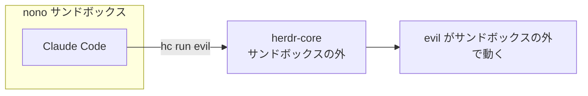
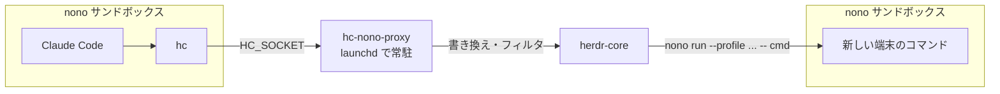

Claude Code を [nono](https://nono.sh) のサンドボックス内で動かしています。サンドボックス内で実行しているときも、ターミナルマルチプレクサの Herdr をエージェントに使わせたいのですが、何もせず Herdr の操作を許可するとサンドボックスを抜けられてしまうため、エージェントと Herdr の間にプロキシを挟む構成を作ってみました。

# 前提

## nono
https://nono.sh

AI エージェントなどのプロセスを、ファイルシステム・ネットワーク・コマンド実行を制限したサンドボックス内で動かすツールです。macOS では Seatbelt を使っています。プロファイル（JSON）で、読み書きできるパスや接続できる Unix ソケットなどを宣言します。

設定しやすく、凝ったこともできるので便利です。たとえば次のようなことができます。

- Claude Code 向けなど、エージェントごとのベースプロファイルが用意されていて、`extends` で継承して差分だけ書ける
- コマンドごとに別のサンドボックスと実行ポリシーを設定できる。たとえば `gh` は `pr view` / `pr diff` などの読み取り系のサブコマンドだけ許可する、といったことができる
- 認証情報をプロキシで注入できる。GitHub のトークンをエージェントに直接渡さずに、`gh` からの API リクエストにだけヘッダーとして付け、さらに HTTP メソッドとパスで許可する API を絞れる
## Herdr / herdr-core
https://herdr.dev

Herdr はエージェント向けのターミナルマルチプレクサです。Herdr には TUI 版もありますが、この記事で扱うのはそちらではなく、デスクトップアプリ版の Herdr と、その裏で端末（プログラム）を管理している herdr-core です。`hc` は herdr-core の CLI です。

- `hc run --bg --name review claude "..."` のように、エージェントが別のエージェントやプログラムを端末で起動できる
- `hc send` / `hc read` / `hc wait` で、起動した端末に指示を送ったり、画面を読んだり、終了を待ったりできる
- `hc` と core は Unix ソケット上の JSON-RPC 2.0（1行1メッセージ）で通信する。たとえば端末の起動は次のようなメッセージになる

```json
{"jsonrpc": "2.0", "id": 1, "method": "terminal.run", "params": {"argv": ["claude", "..."], "cwd": "/path/to/repo", "name": "review"}}
```

メソッドはほかに `terminal.send`（テキストを貼り付けて Enter を押す）、`terminal.keys`（キーを押す）、`terminal.read`（画面を読む）、`terminal.list`（端末の一覧）などがあります。

人間がターミナルでやっている操作を、エージェント自身にやらせられるのが便利なところです。エージェントがサブエージェントを起動して指示を出し、結果を読んで次の作業を割り振るといったオーケストレーションをエージェント自身にやらせることができます。

## 検証環境
- macOS
- nono 0.81.0
- herdr-core（hc）0.1.20

# 課題

herdr-core はサンドボックスの外で常駐しています。そのため、nono の中のエージェントから素直に `hc` を使えるようにすると、次のようになり、サンドボックスを抜けられてしまいます。



# 方針

エージェントの `hc` と core の間にプロキシを挟み、プロキシで次の2つを強制します。

- エージェントが新しい端末を作るときは、必ず nono 管理下でコマンドを実行する
- エージェントが操作できるのは、nono 管理下の端末だけ

それ以外の操作はすべて拒否します。

なお、herdr-core 自体を nono の中で動かしてしまう案を考えましたが、
人間が普段使っている端末は制限入れたくなかったので、採用しませんでした。

# 構成



構成要素は3つです。

1. **hc-nono-proxy**（Python、約340行）: launchd で常駐し、専用の Unix ソケットで待ち受ける。受け取った JSON-RPC を検査・書き換えしてから、本物の herdr-core に転送する。
2. **nono プロファイル**: サンドボックス内からは本物の core のソケットに触れず、プロキシのソケットにだけ接続できるようにする。`HC_SOCKET` 環境変数で `hc` の接続先をプロキシに向ける。
3. **Claude Code の起動スクリプト**: 人間がサンドボックスの外のターミナルから、プロキシ経由で（つまり nono の中で）Claude Code を起動するためのスクリプト。

プロキシの実装（`nono-hc-proxy.py`）と Claude Code の起動スクリプト（`nono-claude`）は gist に置いています。


# プロキシ

https://gist.github.com/nao23/71195b3fe067104c001bdd0dc940365e

基本的には大まかに以下の2つをやっています。

## 新規端末作成時は必ず nono 管理下でコマンドを実行する

エージェントからの `terminal.run` は、次のように書き換えて転送します。

- コマンドは `nono run --profile <profile> -- <元のコマンド>` に包む。`--` の後ろに置くので、エージェントが nono のオプションを差し込むことはできない
- 起動した端末には `nono-sandboxed=1` ラベルを付ける。エージェントが指定したラベルからは、このキーを取り除く
- `on`（別マシンでの実行）は拒否する
- cwd は、プロファイルで読み書きを許可しているディレクトリの配下に限る。許可していない cwd で起動すると、nono が端末で「Share <cwd> with read+write access? [y/N]」と聞いてくる。この端末はエージェントが操作できるので、`y` と答えられてしまうため
- `keep`（プログラムが落ちたら core がシェルを起動し直す機能）は無効にする。core が起動し直すシェルは nono の外で動くため
- `caller` / `parent` を外し、エージェントが他人の端末を親に指定できないようにする

## nono 管理下の端末だけ操作を許可する

`terminal.send` / `read` / `wait` / `kill` などは、対象に `nono-sandboxed=1` が付いている場合だけ通します。

一覧（`terminal.list`）も、nono 管理下の端末だけが返るように絞り込みます。

`file.write` / `machine.exec` / `events.subscribe` など、ここに挙げていないメソッドはすべて拒否します。

# nono プロファイル

プロキシは「サンドボックス内から本物の core に直接つなげない」ことが前提です。プロファイルでは、関係するところを次のように設定しています（抜粋）。

```json
{
  "filesystem": {
    "unix_socket": [
      "/Users/<user>/.local/state/hc-proxy/herdr-core/default/default.sock"
    ],
    "deny": [
      "/Users/<user>/.local/state/herdr-core",
      "/Users/<user>/.config/herdr-app"
    ]
  },
  "environment": {
    "set_vars": {
      "HC_SOCKET": "/Users/<user>/.local/state/hc-proxy/herdr-core/default/default.sock"
    }
  },
  "command_policies": {
    "commands": {
      "hc": {
        "executable": "/Users/<user>/.local/share/herdr-core/active/Herdr Core.app/Contents/MacOS/herdr-core",
        "from": {
          "session": {
            "sandbox": {
              "fs_read": [".", "/Users/<user>/.local/share/herdr-core"],
              "unsafe_macos_seatbelt_rules": [
                "(allow network-outbound (remote unix-socket (path-literal \"/Users/<user>/.local/state/hc-proxy/herdr-core/default/default.sock\")))"
              ]
            }
          }
        }
      }
    }
  }
}
```

- 本物の core の状態ディレクトリ（`~/.local/state/herdr-core`）と herdr-app の設定は `deny` にする
- 接続できる Unix ソケットはプロキシのものだけにする
- `hc` はコマンドポリシーで専用のサンドボックスに入れ、プロキシのソケットへの **connect だけ**を許す

コマンドポリシーには connect だけを許す項目がないので、Seatbelt のルールを直接書いています。`unix_socket_bind` を使うと、bind やソケットのパスへの書き込みまで許してしまいます。そうなると、プロキシが止まっている間に `hc` が自前の core をそのパスに立て、プロキシを迂回できてしまいます。

# Claude Code の起動スクリプト

人間が Claude Code を使い始めるときは、Herdr の普通の（サンドボックス外の）ペインでこのスクリプト（`nono-claude`）を実行します。

https://gist.github.com/nao23/74d2b94c6036ddff2e71b1a852835cb7

最初の Claude Code もプロキシ経由で起動するのは、その端末にも `nono-sandboxed=1` を付ける必要があるからです。ペインで直接 `nono run ... -- claude` と打って起動すると、その端末はプロキシを通らないのでラベルが付きません。すると、プロキシから見て Claude Code 自身の端末は「nono 管理下でない端末」になり、子のエージェントからの報告（`hc send`）など、Claude Code の端末とのやり取りがすべて拒否されてしまいます。

スクリプトがやっていることは次の通りです。

1. 呼び出し元のペインの Herdr のラベル（`herdr.space` / `herdr.tab`）を、本物の core から読む
2. そのラベルを付けて、プロキシ経由で `claude` を起動する。プロキシが nono で包むので、Claude Code は nono の中で動き、`nono-sandboxed=1` も付く
3. Herdr が同じタブに新しいペインとして置いたら、そこにフォーカスを移し、呼び出し元のペインを閉じる

結果として、呼び出し元のペインが nono の中の Claude Code に置き換わった形になります。


# 使い方

1. **プロキシを置く**: gist の `nono-hc-proxy.py` を `~/nono-hc-proxy/` などに置く。起動時に、端末を動かす nono のプロファイル名（`--profile`）と、cwd として許可するディレクトリ（`--cwd-root`、繰り返し指定可）を必ず指定する。`--cwd-root` には、プロファイルで読み書きを許可しているディレクトリを指定する
2. **launchd に登録する**: 次のような plist を `~/Library/LaunchAgents/` に置いて読み込む

   ```xml
   <?xml version="1.0" encoding="UTF-8"?>
   <!DOCTYPE plist PUBLIC "-//Apple//DTD PLIST 1.0//EN" "http://www.apple.com/DTDs/PropertyList-1.0.dtd">
   <plist version="1.0">
   <dict>
   	<key>Label</key>
   	<string>com.example.nono-hc-proxy</string>
   	<key>ProgramArguments</key>
   	<array>
   		<string>/opt/homebrew/bin/python3</string>
   		<string>-I</string>
   		<string>/Users/<user>/nono-hc-proxy/nono-hc-proxy.py</string>
   		<string>--profile</string>
   		<string>my-profile</string>
   		<string>--cwd-root</string>
   		<string>~/src</string>
   		<string>--cwd-root</string>
   		<string>~/work</string>
   	</array>
   	<key>RunAtLoad</key>
   	<true/>
   	<key>KeepAlive</key>
   	<true/>
   	<key>ThrottleInterval</key>
   	<integer>10</integer>
   	<key>StandardOutPath</key>
   	<string>/Users/<user>/nono-hc-proxy/proxy.log</string>
   	<key>StandardErrorPath</key>
   	<string>/Users/<user>/nono-hc-proxy/proxy.log</string>
   </dict>
   </plist>
   ```

   ```sh
   launchctl bootstrap gui/$(id -u) ~/Library/LaunchAgents/com.example.nono-hc-proxy.plist
   ```

   プロキシのファイルとログは、サンドボックス内から書き込めない場所に置きます。`nono-hc-proxy.py` を書き換えたときは `launchctl kickstart -k gui/$(id -u)/com.example.nono-hc-proxy` で再起動します。plist の引数を変えたときは、`launchctl bootout` してから `bootstrap` し直す必要があります。
3. **nono プロファイルを設定する**: 「nono プロファイル側の設定」の内容を、自分のプロファイルに追加する
4. **Claude Code を起動する**: Herdr の普通のペインで `nono-claude` を実行する。そのペインが nono の中の Claude Code に置き換わる。Claude Code を終了すると、端末とペインも消える
5. **確認する**: Claude Code に `hc run` で何か起動させてみて、`hc get <address>` の `labels` に `nono-sandboxed=1` が付いていること、コマンドが `nono run ...` で包まれていることを確かめる

# まとめ

nono のサンドボックス内で動く Claude Code から Herdr を安全に使えるように、エージェントの `hc` と herdr-core の間にプロキシを挟む構成を作りました。

サンドボックスの外で常駐しているデーモン（今回は herdr-core）をサンドボックス内から使わせると、それがそのまま脱出経路になってしまいます。プロキシでは、新しい端末では必ず nono 管理下でコマンドを実行すること、操作できるのは nono 管理下の端末だけにすること、それ以外はすべて拒否することを強制しました。これにより、エージェントにターミナルを操作させる Herdr の便利さを保ったまま、nono の境界を守れるようになりました。
